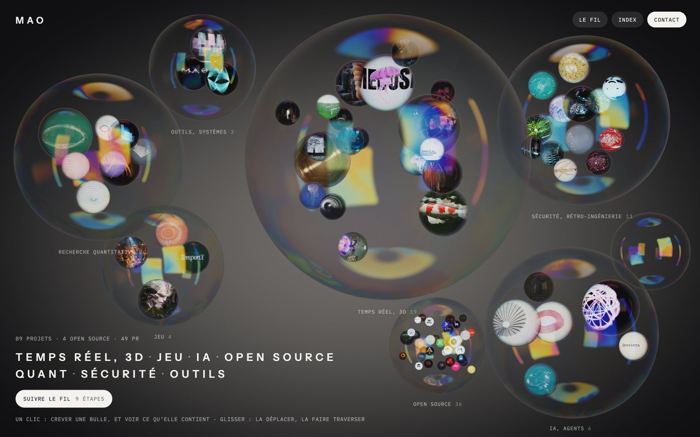

# MAO

**Creative and technical developer** — real-time 3D for the web, AI agents, quantitative research tooling, security.

[**Portfolio**](https://maoxor.pages.dev/) &nbsp;·&nbsp; [Open-source contributions](https://github.com/search?q=author%3Amaoxor+-user%3Amaoxor&type=pullrequests) &nbsp;·&nbsp; [The contributions, mapped](https://maoxor.pages.dev/projets/open-source/) &nbsp;·&nbsp; [Sponsor](https://github.com/sponsors/maoxor)

---

### The portfolio

One WebGL2 scene, written by hand. Seven soap bubbles, one per domain, each holding its projects: burst one to see
what it contains, open a project to read it or to run the work itself. 89 projects, each with its own page; the works
that are online run inside the page.

### Selected work

| Work | What it is |
| --- | --- |
| [**Bulles**](https://maoxor.pages.dev/projets/bulles/) | Each work inside the membrane of a soap bubble, computed in real time. |
| [**La Bibliothèque**](https://maoxor.pages.dev/projets/bibliotheque/) | Borges’ Library of Babel in real time. WebGL2, no dependency. |
| [**NÉBULA**](https://maoxor.pages.dev/projets/nebula/) | A fictional fashion house: five 3D chapters around one coat. |
| [**Koï**](https://maoxor.pages.dev/projets/3dartweb-koi/) | A kohaku koi generated by code: Python, Blender, three.js. |
| [**Pulse**](https://github.com/maoxor/pulse-player) | A music player in a single Custom Element, for every framework. MIT. |
| [**Playbook**](https://github.com/maoxor/ai-assisted-visual-production-playbook) | A public method for producing visuals with an AI coding agent. MIT. |

### Open source

I contribute to open source projects by fixing bugs and improving the tools people rely on every day.
Sponsorship helps me keep doing this work. **[Sponsor me on GitHub →](https://github.com/sponsors/maoxor)**

- **Upstream:** 49 pull requests to 31 projects (read on 29 October 2026). Merged:
  SwiftFormat [#2820](https://github.com/nicklockwood/SwiftFormat/pull/2820), [#2821](https://github.com/nicklockwood/SwiftFormat/pull/2821),
  [#2822](https://github.com/nicklockwood/SwiftFormat/pull/2822), [#2823](https://github.com/nicklockwood/SwiftFormat/pull/2823) ·
  thriftpy2 [#409](https://github.com/Thriftpy/thriftpy2/pull/409) (Python 3.15 wheels) ·
  OmniWM [#837](https://github.com/OmniNull/OmniWM/pull/837). In review at Ruby, RuboCop, typeshed, python-telegram-bot,
  yfinance, ktlint, Prettier PHP and others.
- **Own, under a free licence:** [pulse-player](https://github.com/maoxor/pulse-player) (MIT) ·
  [ai-assisted-visual-production-playbook](https://github.com/maoxor/ai-assisted-visual-production-playbook) (MIT) ·
  [score-to-song](https://github.com/maoxor/score-to-song) (Apache-2.0) · [macos-config](https://github.com/maoxor/macos-config) (MIT).

Contributions are prepared with the help of Claude Code; each project’s maintainers review them and decide.

### Tools

<samp>WebGL2 · GLSL · three.js · Blender (Cycles) · Python · TypeScript · Node · Claude Code</samp>

---

Most repositories are private. The portfolio says what each one is, from the repository itself; nothing private is
published.
